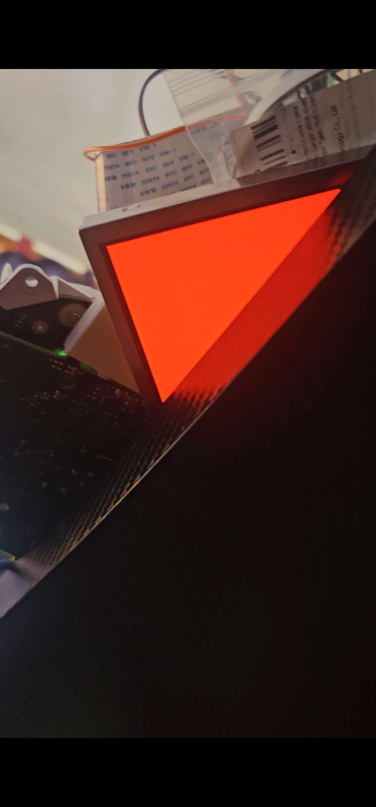
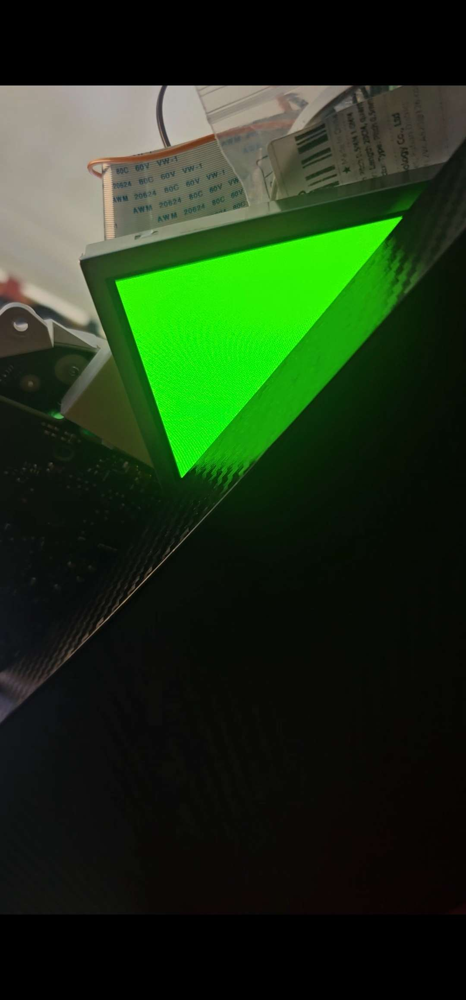
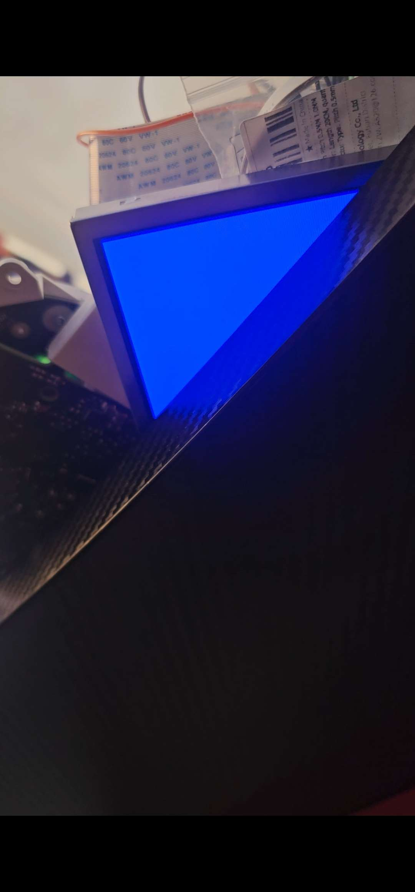
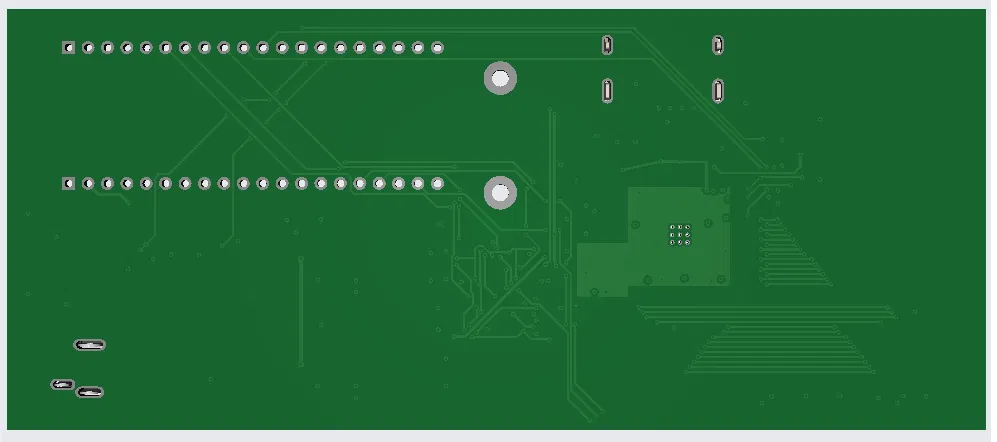
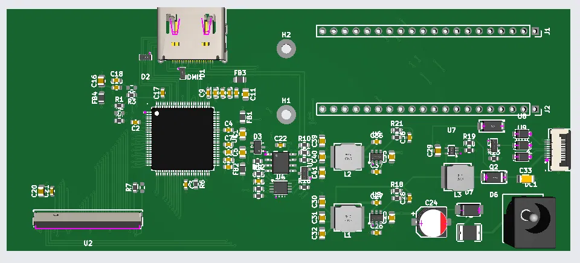
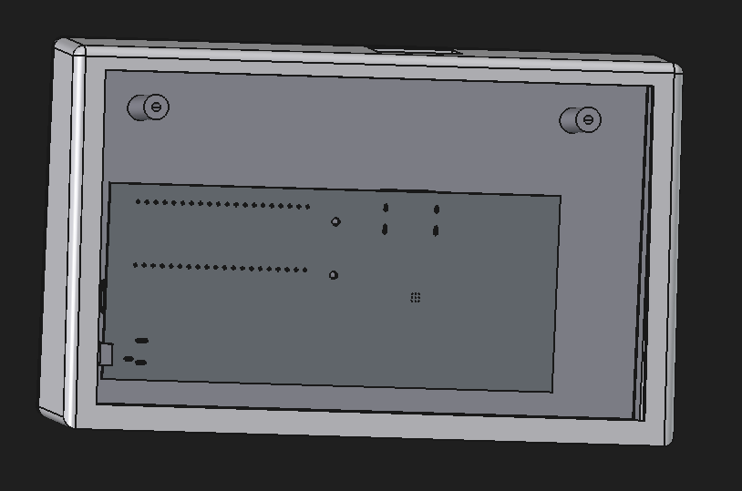
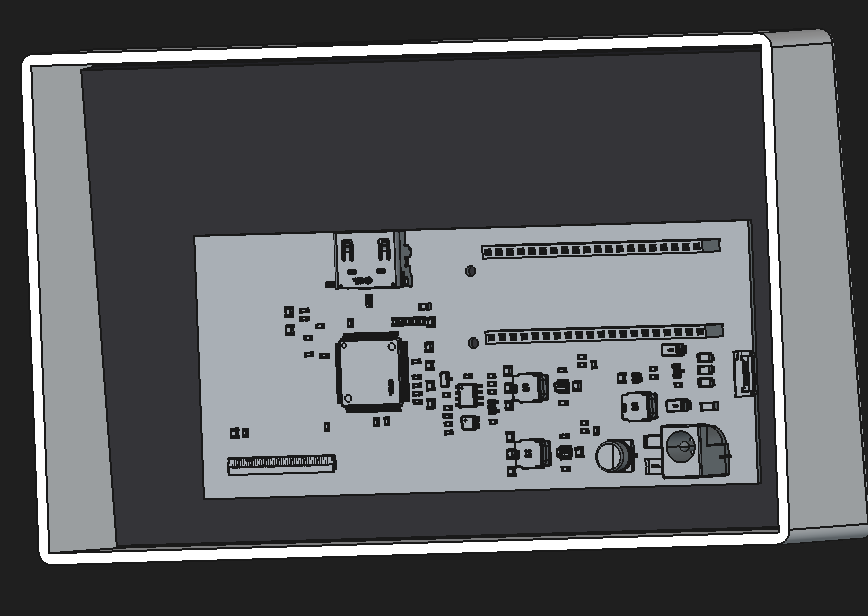

# Cluster2HDMI
A project that converts a 7" screen from a car dashboard to a standalone monitor.

  
  
  

  
  
  
  
  

## Why I made this

This screen comes from an Audi Q7 dashboard. Prior to this project, I was able to control the entire dashboard via CAN. After that, I wanted to control the LCD entirely independently, and use it as a standalone monitor. I have always found it interesting to reverse engineering things, so I believed this project would be a great start, and so far it has.

## What it does

This is a standalone monitor, so it can display graphics or what not connected directly to your PC.

## How it works

A HDMI cable will be plugged into the case, it will function as a secondary monitor, converting HDMI to Parallel RGB on the PCB, via a TFP401 microchip, and sending a  SPI sequence from a Pico 2 to the panel.

## Reverse engineering the panel

Originally, I had tried to search for datasheets available for my panel, but couldn't find any. This meant I had to reverse engineer it myself entirely. I began by connecting the dashboard's ribbon to one FFC breakout board and the panel's flex to another, with jumper wires between them, so I could probe every pin for continuity and voltage with a multimeter while the panel was running. Many problems were met here, more in the [journal](JOURNAL.md).

### Pin map (45-pin, 0.5 mm FPC)

Numbers are the breakout board labels.

| Label | Function | Notes |
|---|---|---|
| 1, 2, 13, 22, 31, 33, 37, 44, 45 | Ground | |
| 3 | Unknown | 1.5 kΩ pull-down to ground |
| 4, 38 | Power in | 3.3V |
| 5–12 | Blue B0–B7 | 5 = smallest bit |
| 14–21 | Green G0–G7 | 14 = smallest bit |
| 23–30 | Red R0–R7 | 23 = smallest bit |
| 32 | PCLK | Pixel clock |
| 34 | HSYNC | |
| 35 | VSYNC | |
| 36 | DE | Data enable |
| 39, 43 | Not connected | Unknown |
| 40 | SPI data (MOSI) | Setup commands |
| 41 | SPI chip select | Active low |
| 42 | SPI clock | |

### Video timing (measured from the cluster)

| | Value |
|---|---|
| Resolution | 800 × 480 |
| Pixel clock | ~26.8 MHz (cluster), 25 MHz (Pico) |
| Horizontal | HSYNC 10 px, back porch 6 px, active 800 px, front porch 106 px, total 922 px |
| Vertical | active 480 lines, front porch 8, VSYNC 4, back porch 8, total 500 lines |
| Refresh rate | ~58 Hz (cluster), ~54 Hz (Pico) |
| Sync polarity | HSYNC and VSYNC active low, DE active high |

### SPI setup sequence

The sequence that the cluster sends to the panel to 'stay alive', or a gamma/brightness setting. It consists of 3 wires at ~500 kHz. It starts ~25 ms after video starts, and without it the panel stays black.

| Step | Bytes (hex) | Delay after |
|---|---|---|
| 1 | 1B 50 00 | 2.15 ms |
| 2 | 1D 5C 00 | 2.15 ms |
| 3 | 10 00 | 2.15 ms |
| 4 | 08 80 | ~125.6 ms |
| 5 | 14 80 | |

The cluster repeats the whole set every ~545.6 ms. What each register does is unknown.

## Current status

The design is finished, including the PCB, case, and firmware, and is waiting on funding to order and build.

## Wiring (current test setup)

Breakout A = panel side, Breakout B = cluster side.

### Timing and SPI

| Pico 2 | Breakout A | Signal |
|---|---|---|
| GP0 | 32 | PCLK |
| GP1 | 36 | DE |
| GP2 | 34 | HSYNC |
| GP27 | 35 | VSYNC |
| GP28 | — | Not connected (used internally by the Pico) |
| GP21 | 42 | SPI clock |
| GP22 | 40 | SPI data (MOSI) |
| GP26 | 41 | SPI chip select |
| GND | Ground rail | Ground |

### Colour data (top 6 bits of each colour)

| Colour | Bit | Breakout A | Pico 2 |
|---|---|---|---|
| Blue | B2 | 7 | GP5 |
| Blue | B3 | 8 | GP6 |
| Blue | B4 | 9 | GP7 |
| Blue | B5 | 10 | GP8 |
| Blue | B6 | 11 | GP3 |
| Blue | B7 | 12 | GP9 |
| Green | G2 | 16 | GP12 |
| Green | G3 | 17 | GP13 |
| Green | G4 | 18 | GP14 |
| Green | G5 | 19 | GP4 |
| Green | G6 | 20 | GP15 |
| Green | G7 | 21 | GP10 |
| Red | R2 | 25 | GP18 |
| Red | R3 | 26 | GP19 |
| Red | R4 | 27 | GP20 |
| Red | R5 | 28 | GP11 |
| Red | R6 | 29 | GP16 |
| Red | R7 | 30 | GP17 |

### Resistors to ground

| Breakout A | Resistor | Why |
|---|---|---|
| 3 | 1 kΩ | 1.5 kΩ pull-down |
| 5, 6 | 2.2 kΩ each | Blue B0–B1 held low (unused) |
| 14, 15 | 2.2 kΩ each | Green G0–G1 held low (unused) |
| 23, 24 | 2.2 kΩ each | Red R0–R1 held low (unused) |

### Cluster to panel (breakout B → breakout A)

| Connection | Purpose |
|---|---|
| B4 → A4 | Panel power from the cluster |
| B38 → A38 | Panel power from the cluster |
| A1, 2, 13, 22, 31, 33, 37, 44, 45 → ground rail | Panel grounds |
| B1, 22, 44 → ground rail | Cluster ground |
| A39, A43 | Left unconnected |
| 10-pin backlight ribbon | Stays plugged into the cluster |

Power order: cluster on first, then plug in the Pico.

## Hardware

The TFP401 converts HDMI to parallel RGB, and the SPI sequence comes from the Pico
### Video path
HDMI input, into the TFP401 chip, outputting TTL/Parallel RGB, and connects to the 45-pin connector
### Power
12V input, converted to 5V, 3.3V, and 22.5V, via buck converters and boost converters, with a resettable fuse (F2)
### Backlight
Driven by the 22.5V, with 3 LED strings that return through a 20mA constant-current chip. A MOSFET then switches them with PWM from the Pico for brightness.
### Pico 2
SPI sequence on pins 4-6 of the 45-pin connector, the backlight, and the EDID.
### EDID
A memory chip (AT24C02 EEPROM) on the HDMI's DDC lines. The Pico writes it through a level shifter, and it tells the PC the screens resolution, and monitor name.

## Firmware

Currently, the Pico code is MicroPython, written and run through Thonny. It generates the timing signals (PCLK, HSYNC, VSYNC, DE) using the Pico's PIO hardware, sends the SPI  sequence, and controls the red, green and blue bits. The test firmware was written with help from Claude (AI), and is able to send the SPI sequence, turn backlight on, and write the EDID with the correct resolution and monitor name. Code can be found [here](Firmware), the file is cluster2hdmi_main.py. It is still, however, untested, as the PCB hasn't been ordered yet.

## How to flash

1. Holding BOOTSEL, plug in your Pico, and drag the [MicroPython .uf2 file](https://micropython.org/download/RPI_PICO2/) onto the drive that appears.
2. Open Thonny and choose the Pico as the interpreter, before saving the [firmware](Firmware) file onto the Pico as "main.py". After this, it'll run automatically on power-up. 
3. Turn on the Pico 2, and the software should run!

## Known issues

* Pins 3, 39 and 43's functions are unknown
* Exactly what each SPI register does is unknown, but easily replicable
* Unknown whether the panel needs SPI commands repeated
* Pico test driver uses 6 bits per colour, not 8, and can only show solid colours
* Loose wiring can cause unexpected disconnections

## Building one yourself

1. Ordering all required parts: BOM, + specific JLC parts. Gerbers available in KiCad/Cluster2HDMI/gerbers.zip, and JLC BOM and CPL are in KiCad/Fabrication
2. Soldering the 20pin female headers for the Pico 2 is required, as JLC is out of stock of them
3. Printing the case, case_shell.stl and case_back_cover.stl
4. Putting it together: PCB screws onto 2 posts on the back cover with M2x8 screws, 45-pin and 10-pin ribbons connect to the board, Pico to its socket, and finally, the cover going into the shell, with 2 M2 x 30 screws going through the cover into the panel's top holes
5. Powering it up, the Pico writes the EDID, so the cable needs unplugging and replugging once before the PC sees the screen properly.

## Bill of Materials

All prices in USD (AliExpress prices converted from AUD). Full list with notes: [bom.csv](bom.csv). Every part on the PCB (with LCSC numbers) is in [KiCad/Fabrication/Cluster2HDMI_BOM_JLC_v2.csv](KiCad/Fabrication/Cluster2HDMI_BOM_JLC_v2.csv).

| Item | Qty | Cost (USD) | Where |
|---|---|---|---|
| Cluster2HDMI PCB (4-layer, 1.6 mm, HASL) | 5 | 29.40 | [JLCPCB](https://jlcpcb.com) |
| PCB assembly (Economic PCBA) | 2 | 97.14 | [JLCPCB](https://jlcpcb.com) |
| JLCPCB shipping (Global Standard Direct Line) | 1 | 7.21 | [JLCPCB](https://jlcpcb.com) |
| JLCPCB GST (10%) | 1 | 13.38 | [JLCPCB](https://jlcpcb.com) |
| 12 V 2 A power adapter (AU plug, 5.5 x 2.1 mm) | 1 | 2.81 | [AliExpress](https://www.aliexpress.com/item/1005010390772322.html) |
| 1x20 2.54 mm female pin socket (pack of 10) | 1 pack | 1.13 | [AliExpress](https://www.aliexpress.com/item/32852994833.html) |
| Pin socket shipping | 1 | 1.65 | [AliExpress](https://www.aliexpress.com/item/32852994833.html) |
| M2 x 30 mm pan head screw (pack of 25) | 1 pack | 2.06 | [AliExpress](https://www.aliexpress.com/item/1005002205244614.html) |
| M2 x 8 mm pan head screw (pack of 25) | 1 pack | 1.47 | [AliExpress](https://www.aliexpress.com/item/1005002205244614.html) |
| HDMI cable 2 m | 1 | 3.76 | [AliExpress](https://www.aliexpress.com/item/1005005181822494.html) |
| PLA filament 1 kg (case uses ~100 g) | 1 | 23.06 | [AliExpress](https://www.aliexpress.com/item/1005007175412873.html) |
| AliExpress GST (10%) | 1 | 3.59 | [AliExpress](https://www.aliexpress.com) |
| Raspberry Pi Pico 2 | 1 | owned | [Raspberry Pi](https://www.raspberrypi.com/products/raspberry-pi-pico-2/) |
| Audi Q7 4M0 920 781 A cluster (LCD panel) | 1 | owned | [eBay](https://www.ebay.co.uk/itm/177800811902) |
| **Total** | | **186.66** | |

## Credits & references

- [LogicAnalyzer by gusmanb](https://github.com/gusmanb/logicanalyzer)
- [Adafruit TFP401 HDMI/DVI decoder](https://www.adafruit.com/product/2219)
- Claude (AI): helped write the test firmware, decode the logic analyser captures, routing the PCB, and aided with designing the case

## Licence

MIT, see [LICENSE](LICENSE).
